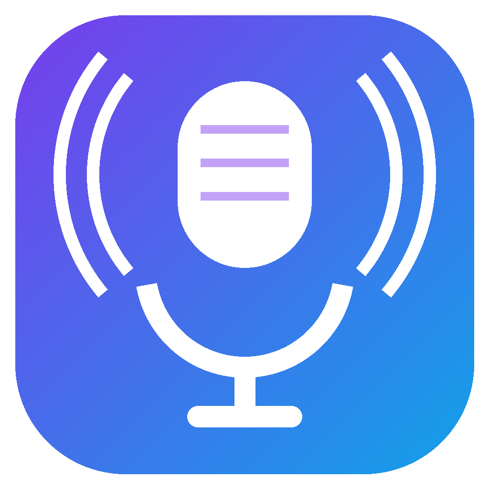

<p align="center"></p>

# Mikraf

Mikrofonuna Windows seviyesinde ses efektleri ekleyen küçük bir program. Gürültü engelleme, gate, kazanç, expander, EQ, kompresör ve limiter zincirini mikrofonun kendisine uygular. Discord, Audacity, OBS gibi seçili mikrofonu açan her program efektli sesi duyar.

## Kurulum

[Releases](https://github.com/ruwiss/mikraf/releases) sayfasından `Mikraf-Setup-x.y.z.exe` indirip çalıştır. Kurulum yönetici izni ister.

1. Mikraf'i aç, mikrofonunu seç.
2. Efektleri ayarla.
3. **Uygula**'ya bas (yönetici izni ister). Efekt mikrofona yazılır.
4. Diğer programlarda aynı mikrofonu seç.

Üstteki **Efektler açık** kutusu efekti anlık açıp kapatır, ses olduğu gibi geçer.

Kaldırırken mikrofon kaydındaki efekt bağlantısı otomatik temizlenir.

## Kaynaktan derleme

Gerekenler: .NET 9 SDK, LLVM (clang-cl), Visual Studio 2022 C++ araçları, Windows SDK, Inno Setup 6.

```powershell
powershell -File native\build.ps1          # speex / rnnoise
powershell -File apo\build.ps1             # mikraf-apo.dll
dotnet publish -c Release -r win-x64 --self-contained true -p:PublishSingleFile=true -p:IncludeNativeLibrariesForSelfExtract=false -o hazir
iscc installer\mikraf.iss                  # dist\Mikraf-Setup-x.y.z.exe
```

## Yapı

- `apo/` Windows capture APO (`audiodg.exe` içinde çalışır) ve DSP zinciri
- `native/` Speex ve RNNoise sarmalayıcıları
- `*.cs` WinForms arayüzü, ayar köprüsü, kurulum
- `installer/` Inno Setup betiği

Üçüncü taraf lisansları için `NOTICES.txt`.
